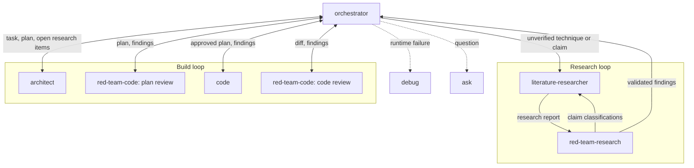

# Multi-Agent Setup for Claude Code

A set of eight specialized Claude Code subagents that split software work into planning, implementation, debugging, research, and adversarial review, plus a `CLAUDE.md` template with the shared standards the agents assume.

## Agents

| Agent | Model | Tools | Use it for |
|---|---|---|---|
| `orchestrator` | Opus | Read, Grep, Glob, Agent | Breaking a large task into subtasks and delegating to the other agents. It has no write tools. |
| `architect` | Sonnet | Read, Grep, Glob, Edit, Write | Planning before implementation. It writes a todo-style plan file and does not implement it. |
| `code` | Sonnet | Read, Grep, Glob, Edit, Write, Bash, PowerShell | Implementing features, fixes, and refactors. |
| `debug` | Sonnet | Read, Grep, Glob, Edit, Write, Bash, PowerShell | Diagnosing failures. It lists candidate causes, instruments to test them, and confirms the diagnosis with you before fixing. |
| `ask` | Sonnet | Read, Grep, Glob, WebFetch, WebSearch | Read-only explanations and answers. It makes no changes. |
| `literature-researcher` | Opus | Read, Grep, Glob, Edit, Write, WebFetch, WebSearch, Bash, PowerShell | Source-verified surveys of papers, algorithms, and reference code, run before a design is finalized. Unverifiable claims are labeled "⚠️ Unverified". |
| `red-team-code` | Sonnet | Read, Grep, Glob, Write, Bash, PowerShell | Auditing code against an independently stated purpose, or pressure-testing a plan for dead ends. Findings only. |
| `red-team-research` | Opus | Read, Grep, Glob, WebFetch, WebSearch, Bash, PowerShell | Auditing a paper, RFC, design doc, or benchmark writeup, including the output of `literature-researcher`. Claims are classified Verified, Unverified, Contradicted, or Unfalsifiable. Critique only. |

Opus is used for the three agents whose errors propagate furthest: the coordinator and the research pair, where a missed or fabricated claim can steer an entire design. Sonnet is sufficient for the rest.

## Workflow

Only the orchestrator starts agents, and it drives both loops. Every arrow in the Build loop passes through it, since `architect` and the other agents never spawn anything themselves:

- **Research loop (`literature-researcher` ⇄ `red-team-research`).** The orchestrator starts `literature-researcher`, either on its own initiative or because `architect` listed an open research item in its plan. As soon as the report arrives, `red-team-research` audits its claims, and its Verified/Unverified/Contradicted/Unfalsifiable classifications go back to `literature-researcher` to correct or re-verify. The loop repeats until the stop condition below is met, and only then are the findings used in planning. If the research came from an open research item, the orchestrator sends the plan back to `architect` with the validated findings.
- **Build loop (`architect` → `red-team-code` → `code` ⇄ `red-team-code`).** `architect` turns the task into a plan and hands it back. The orchestrator has `red-team-code` pressure-test the plan, returns findings to `architect` for revision, and once the plan is approved has `code` implement it. `red-team-code` then reviews the result, and `code` revises against its findings. `architect` asks you its clarifying questions and gets your approval on the plan directly.

### Research loop stop condition

Literature review is token-intensive, so the loop spends fully on the first round and narrows afterward:

- **Round 1:** full-breadth survey and full audit.
- **Rounds 2+:** `literature-researcher` re-verifies only the flagged claims, and `red-team-research` audits only the revised and newly introduced claims. Cost scales with the number of disputed claims, not the size of the survey.

The orchestrator stops the loop when all of these hold:
- No claim is Contradicted.
- Every load-bearing claim is Verified, or is Unverified with a documented reason verification is infeasible (paywall, dead link, no primary source). Those are passed on as stated uncertainty and not retried.
- Only peripheral findings remain. They are recorded and passed on without triggering another round.

Two guardrails stop the loop regardless:
- **Round cap of 3** (one full round plus two targeted rounds). Unresolved load-bearing claims are returned labeled ⚠️ and reported to you.
- **No-progress exit.** A round that resolves none of the previously flagged claims ends the loop.

To prevent the loop from converging by quietly narrowing scope, `literature-researcher` must list any claim it removes as "withdrawn". The cap of 3 is a judgment call and not an empirically tuned value, so adjust it in `orchestrator.md` if loops end too early or run long.

Both loops are adversarial by design: the producing agent (`literature-researcher`, `code`) and the critic (`red-team-research`, `red-team-code`) refine each other, and the critics never write the fix. `debug` and `ask` sit outside the loops and are called as needed.

Design rules baked into the prompts:
- **Review agents give findings, not fixes.** `red-team-research` never proposes remediation, and `red-team-code` proposes none on plans or behavioral gaps. The only exception is a one-sentence comparative note on bloat findings.
- **Purpose comes from independent sources.** `red-team-code` takes the spec from a ticket, PR description, or your statement, never from the code's own comments.
- **Planners don't implement or spawn.** `architect` hands its plan back to the orchestrator, which decides what runs next. It lists unverified techniques as open research items and does not research them itself.
- **Debugging confirms before fixing.** `debug` asks you to confirm the diagnosis before it changes anything.

## Install

1. Copy the agent files:
   - **Global (all projects):** `agents/*.md` → `~/.claude/agents/`
   - **Single project:** `agents/*.md` → `<project>/.claude/agents/`
2. Merge `CLAUDE.template.md` into your `~/.claude/CLAUDE.md` (global) or `<project>/CLAUDE.md`. The agents' behavior, such as the factuality labels and the independent-purpose rule, assumes these standards.
3. Restart Claude Code or reload agents so the new definitions are picked up.

The git-reserved section of the template is commented out because it is a personal preference. Uncomment it if you want agents to leave all git operations to you.

## Caveats

- **Write restrictions are prompt-enforced only.** `red-team-code` is told to write only under `tests_scratch/`, and `red-team-research` is told never to edit files. Both keep Bash, so nothing technical stops them. Remove Bash and Write from the frontmatter if you need a hard guarantee.
- **The orchestrator hardcodes agent names.** If you rename or remove an agent, update the delegation sections in `orchestrator.md`, plus the cross-references in `literature-researcher.md`, `red-team-code.md`, and `red-team-research.md`.
- **Path conventions are assumed.** `architect` writes plans to `/plans` if it exists, `literature-researcher` writes reports to `docs/research/`, and `red-team-code` writes probes to `tests_scratch/`. Adjust the prompts if your layout differs.
- **Tool names follow Claude Code's current naming** (`Agent`, `PowerShell`, and so on). `PowerShell` only applies on Windows, so drop it from `tools:` on other platforms.
