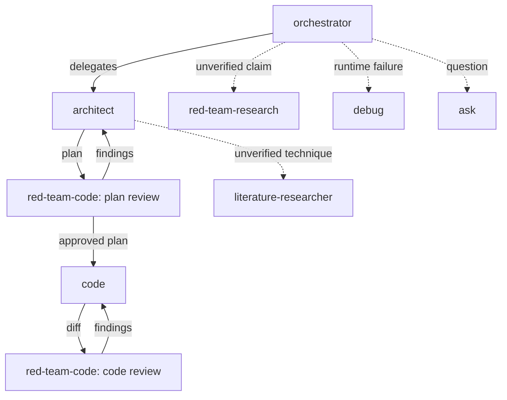

# Multi-Agent Setup for Claude Code

A set of eight specialized Claude Code subagents that split software work into planning, implementation, debugging, research, and adversarial review, plus a `CLAUDE.md` template with the shared standards the agents assume.

## Agents

| Agent | Tools | Use it for |
|---|---|---|
| `orchestrator` | Read, Grep, Glob, Agent | Breaking a large task into subtasks and delegating to the other agents. It has no write tools. |
| `architect` | Read, Grep, Glob, Edit, Write | Planning before implementation. It writes a todo-style plan file and does not implement it. |
| `code` | Read, Grep, Glob, Edit, Write, Bash, PowerShell | Implementing features, fixes, and refactors. |
| `debug` | Read, Grep, Glob, Edit, Write, Bash, PowerShell | Diagnosing failures. It lists candidate causes, instruments to test them, and confirms the diagnosis with you before fixing. |
| `ask` | Read, Grep, Glob, WebFetch, WebSearch | Read-only explanations and answers. It makes no changes. |
| `literature-researcher` | Read, Grep, Glob, Edit, Write, WebFetch, WebSearch, Bash, PowerShell | Source-verified surveys of papers, algorithms, and reference code, run before a design is finalized. Unverifiable claims are labeled "⚠️ Unverified". |
| `red-team-code` | Read, Grep, Glob, Write, Bash, PowerShell | Auditing code against an independently stated purpose, or pressure-testing a plan for dead ends. Findings only. |
| `red-team-research` | Read, Grep, Glob, WebFetch, WebSearch, Bash, PowerShell | Auditing a paper, RFC, design doc, or benchmark writeup. Claims are classified Verified, Unverified, Contradicted, or Unfalsifiable. Critique only. |

All eight are set to `model: sonnet`.

## Workflow

Typical path: `architect` produces a plan, `red-team-code` pressure-tests it, you approve, `code` implements, and `red-team-code` reviews the result. `literature-researcher` verifies published techniques a design depends on, and `red-team-research` checks existing artifacts before they are trusted.

Design rules baked into the prompts:
- **Review agents give findings, not fixes.** `red-team-research` never proposes remediation, and `red-team-code` proposes none on plans or behavioral gaps. The only exception is a one-sentence comparative note on bloat findings.
- **Purpose comes from independent sources.** `red-team-code` takes the spec from a ticket, PR description, or your statement, never from the code's own comments.
- **Planners don't implement.** `architect` hands off to `code` or `debug`.
- **Debugging confirms before fixing.** `debug` asks you to confirm the diagnosis before it changes anything.

## Install

1. Copy the agent files:
   - **Global (all projects):** `agents/*.md` → `~/.claude/agents/`
   - **Single project:** `agents/*.md` → `<project>/.claude/agents/`
2. Merge `CLAUDE.template.md` into your `~/.claude/CLAUDE.md` (global) or `<project>/CLAUDE.md`. The agents' behavior, such as the factuality labels and the independent-purpose rule, assumes these standards.
3. Restart Claude Code or reload agents so the new definitions are picked up.

The git-reserved section of the template is commented out because it is a personal preference. Uncomment it if you want agents to leave all git operations to you.

## Caveats

- **Write restrictions are prompt-enforced only.** `red-team-code` is told to write only under `tests_scratch/`, and `red-team-research` is told never to edit files. Both keep Bash, so nothing technical stops them. Remove Bash and Write from the frontmatter if you need a hard guarantee.
- **The orchestrator hardcodes agent names.** If you rename or remove an agent, update the delegation sections in `orchestrator.md`, `architect.md`, and `red-team-code.md`.
- **Path conventions are assumed.** `architect` writes plans to `/plans` if it exists, `literature-researcher` writes reports to `docs/research/`, and `red-team-code` writes probes to `tests_scratch/`. Adjust the prompts if your layout differs.
- **Tool names follow Claude Code's current naming** (`Agent`, `PowerShell`, and so on). `PowerShell` only applies on Windows, so drop it from `tools:` on other platforms.
